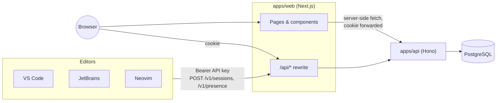
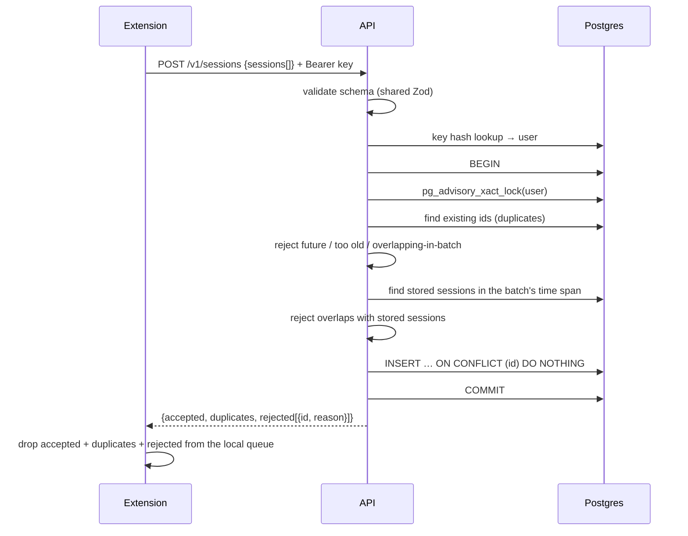

# Architecture

## Components

| Component                      | Responsibility                                                                                                                                                                |
| ------------------------------ | ----------------------------------------------------------------------------------------------------------------------------------------------------------------------------- |
| **Editor extensions**          | Detect coding sessions (start on activity, end on idle, blur or file change), queue them on disk, send batches, send presence heartbeats. See [extensions.md](extensions.md). |
| **API** (`apps/api`)           | Authenticate, validate, store sessions idempotently, enforce plausibility, compute stats, the leaderboard and presence. The only component that touches the database.         |
| **Web** (`apps/web`)           | Render pages. Server components read through the API; client components call `/api/*`. Holds no business logic and no database access.                                        |
| **Shared** (`packages/shared`) | The wire contract: Zod schemas, TypeScript types and limits. The API validates with them; the web and extensions build against them.                                          |

## Principles

1. **One origin for browsers.** The web app rewrites `/api/*` to the API. The session cookie is
   first-party, the API needs no CORS, and cross-site requests can't reach the cookie endpoints.
2. **The client is untrusted.** Extensions are open source and their requests can be forged. The
   server bounds what any account can claim (sessions can't overlap or lie in the future) instead of
   trying to authenticate the client binary. See [ADR 0002](adr/0002-no-request-signing.md) and
   [ADR 0004](adr/0004-overlap-based-plausibility.md).
3. **Retries are safe.** Every session carries a client-generated UUID. Re-sending is reported as a
   duplicate and never double-counts.
4. **Boring storage until it hurts.** Postgres only: no Redis, queues or rollup tables until a
   measured need ([ADR 0003](adr/0003-postgres-only.md)).
5. **Contract first.** Shapes and limits live in one place (`packages/shared`) and are documented in
   [api.md](api.md).

## Request flows

### Session ingestion

The advisory lock serialises batches for the same user, so two concurrent uploads of overlapping
sessions can't both pass the overlap check.

### Login

1. Browser opens `/api/auth/github`. The API sets a short-lived `fy_oauth_state` cookie and
   redirects to GitHub.
2. GitHub redirects to `/api/auth/github/callback`. The API checks the state, exchanges the code,
   fetches the profile, and upserts the user by GitHub id.
3. The API creates a session (random 256-bit token; only its SHA-256 is stored), sets it as an
   `HttpOnly`, `SameSite=Lax` cookie (`__Host-fy_session` in production), and redirects to `/dashboard`.
4. Sessions last 30 days and slide: use in the second half extends them.

### Presence

- While the user is active, the extension sends `POST /v1/presence {online: true, language}` every
  60 s; on idle, blur or exit it sends `{online: false}`.
- A user is **online** if `last_seen_at` is under 150 s old **and** they haven't signed off since.
  A crashed editor times out on its own.
- Users can hide their presence or the language shown with it (`/settings`).

### Reads

- **Stats** (`/v1/me/stats`): aggregated on request from `coding_sessions` for the signed-in user,
  bucketed by day in the viewer's time zone (sent by the browser). Projects are private to the owner.
- **Leaderboard** (`/v1/leaderboard`): rolling 1/7/30-day windows, top 100. The query is the most
  expensive read, so requests never wait for it: the API caches each range in-process for 30 s,
  serves the stale copy while one background refresh runs, and warms all ranges at startup. The
  web app caches it for another 30 s. Measurements: [performance.md](performance.md).

## Security summary

| Concern         | Approach                                                                                                      |
| --------------- | ------------------------------------------------------------------------------------------------------------- |
| Stolen database | Tokens and API keys are stored as SHA-256 hashes only                                                         |
| CSRF            | No CORS + same-origin proxy + `SameSite=Lax` cookies; API keys can't use cookie-only endpoints and vice versa |
| Inflated time   | Server-side plausibility: no overlapping or future sessions, bounded length and age                           |
| Key leaks       | `fy_` prefix (easy to spot in scans), per-device keys, revocation, `last_used_at`                             |
| Old 1.x clients | Legacy endpoints answer `410 Gone` with an update message                                                     |

## What's deliberately not here

Colleges, devlogs, work experience, "Wrapped", roles/RBAC and non-GitHub logins were cut from 2.0
to keep the core small and reliable. Add them back only with an ADR.
