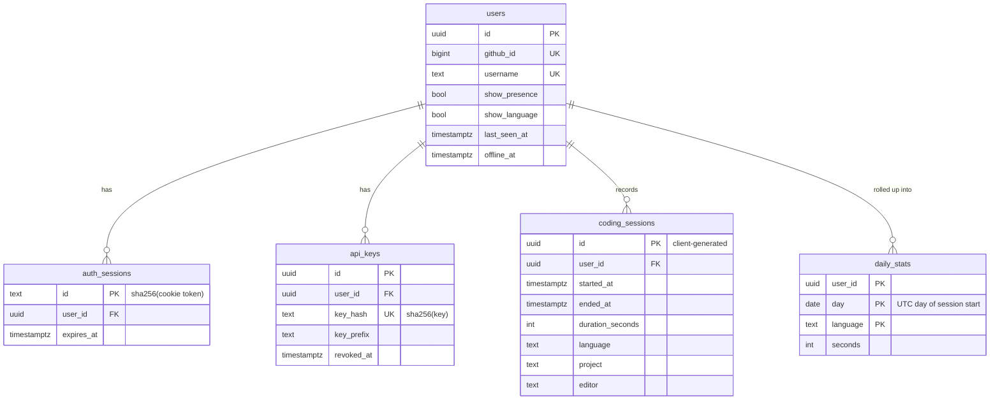

# Data model

Defined in `apps/api/src/db/schema.ts`; migrations in `apps/api/drizzle/`.

## Tables

**`users`**: one row per GitHub account. Identity is `github_id`; `username` follows GitHub renames
on each login. If a username moves to a different GitHub account, the stale row becomes
`<username>~<github_id>` until that person logs in again. Presence lives here (`last_seen_at`,
`offline_at`, `presence_language`, `presence_editor`) because it's a single small row per user.

**`auth_sessions`**: browser logins. The primary key is the SHA-256 of the cookie token. 30-day
sliding expiry; expired rows are deleted when they're next presented.

**`api_keys`**: editor credentials. Only `key_hash` is stored; `key_prefix` (`fy_xxxx`) is for
display. Revoking sets `revoked_at`, which keeps history for `last_used_at`.

**`daily_stats`**: seconds per user, UTC day and language, rolled up from `coding_sessions` so the
leaderboard doesn't have to add up millions of sessions ([ADR 0006](adr/0006-daily-stats-rollup.md)).
`ingestSessions` updates it in the same transaction that inserts sessions, from the rows actually
inserted. `pnpm --filter @forkyou/api db:rebuild-rollups` recomputes it from scratch.

**`coding_sessions`**: the fact table. Indexed on `(user_id, started_at)` for per-user reads and on
`started_at` for leaderboard windows. File paths are deliberately not stored.

## Invariants

| Invariant                                                                        | Enforced by                                              |
| -------------------------------------------------------------------------------- | -------------------------------------------------------- |
| A user's sessions never overlap (beyond 2 s edge tolerance)                      | `ingestSessions` under a per-user advisory lock          |
| `ended_at > started_at`, `duration_seconds > 0`                                  | Check constraints                                        |
| A session id is stored at most once                                              | Primary key + `ON CONFLICT DO NOTHING`                   |
| One user per GitHub id; usernames unique                                         | Unique constraints + `upsertGithubUser`                  |
| No plaintext secrets at rest                                                     | Only hashes stored for session tokens and API keys       |
| `daily_stats` equals the sum of `coding_sessions` per user, UTC day and language | `ingestSessions` (same transaction); `rebuildDailyStats` |

Because sessions never overlap, a user's total time over any window can't exceed the wall-clock
length of that window. That's the core anti-cheat property.

## Migrations

1. Edit `schema.ts`.
2. `pnpm db:generate` writes SQL to `apps/api/drizzle/` and updates `drizzle/meta`.
3. Review the SQL, then commit both.
4. Migrations run automatically when the API container starts (`dist/db/migrate.js`).

Never edit a migration that has been merged. Write a new one. For destructive changes (dropping a
column the running version still reads), split into two deploys: stop using it, then drop it.

## Growth plan

Personal stats are computed from `coding_sessions` on read; the `(user_id, started_at)` index keeps
them fast. The leaderboard reads the `daily_stats` rollup, so its cost grows with users × days
rather than with sessions. Measurements: [performance.md](performance.md).
